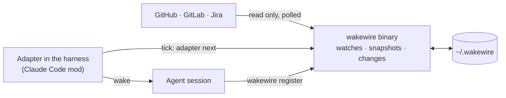

# wakewire

wakewire wakes an agent session when something it waits on changes on
GitHub, GitLab or Jira: a review on its pull request, an answer on its spec,
a label that says build it. It exists because an agent waiting on people
moves only when a person writes to its session, and nothing tells it that
someone answered elsewhere. It is shaped as a command-line binary that knows
the services and keeps the state, plus a small adapter inside each harness
that keeps time and delivers the wake, so that nothing runs in the
background, nothing found is ever lost, and a new harness costs only an
adapter. Its first user is unattendish's run-fleet, in Claude Code; bb comes
later.

Status: designed, not built. The design is in the [docs](docs/README.md).
