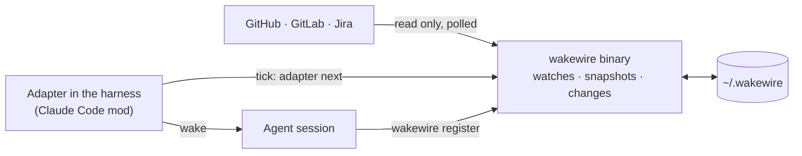

# wakewire

wakewire wakes an agent session when something it waits on changes on
GitHub, GitLab or Jira: a review on its pull request, an answer on its spec,
a label that says build it. It exists because an agent waiting on people
moves only when a person writes to its session, and nothing tells it that
someone answered elsewhere. It is shaped as a command-line binary that knows
the services and keeps the state, plus a small adapter inside each harness
that keeps time and delivers the wake, so that nothing runs in the
background, nothing found is ever lost, and a new harness costs only an
adapter. Its first user is unattendish's run-fleet, in Claude Code; bb comes
later.



How it works and why, every command and file, and the wake contract are in
the [docs](docs/README.md).

## Install

wakewire is two pieces: the `wakewire` binary, and the mod that wakes Claude
Code sessions. Install both.

### The binary

From a release, for Linux or macOS on amd64 or arm64; pick the archive for
your system on the [releases page](https://github.com/gperezmz/wakewire/releases):

```sh
VERSION=0.1.0-rc.1
OS=linux ARCH=amd64        # or darwin, and arm64
curl -fsSLO "https://github.com/gperezmz/wakewire/releases/download/v$VERSION/wakewire_${VERSION}_${OS}_${ARCH}.tar.gz"
curl -fsSLO "https://github.com/gperezmz/wakewire/releases/download/v$VERSION/checksums.txt"
sha256sum --check --ignore-missing checksums.txt   # on macOS: shasum -a 256 --check --ignore-missing checksums.txt
tar -xzf "wakewire_${VERSION}_${OS}_${ARCH}.tar.gz" wakewire
install -m 755 wakewire ~/.local/bin/wakewire      # any folder on PATH
wakewire version
```

With Homebrew, on macOS or Linux; this repository is its own tap, which
Homebrew asks you to trust once:

```sh
brew tap gperezmz/wakewire https://github.com/gperezmz/wakewire
brew trust gperezmz/wakewire
brew install --cask wakewire
```

With Nix, built from source:

```sh
nix run github:gperezmz/wakewire -- version
nix profile install github:gperezmz/wakewire
```

Or with Go 1.27.2 or later:

```sh
go install github.com/gperezmz/wakewire/cmd/wakewire@latest
```

### The Claude Code mod

```sh
claude plugin install wakewire --marketplace gperezmz/wakewire
```

The mod is a Claude Code plugin whose hooks module runs inside the session;
it needs function hooks enabled, and the `wakewire` binary on `PATH`. In a
session, the footer shows `● wakewire` while the session holds a watch, and
`/wakewire status` shows its details.

## Set up an account

An account says which token reads which repositories or Jira site. The token
is checked before anything is written; a stored one goes to
`~/.wakewire/credentials.toml` (mode 600), never to `config.toml`.

```sh
# GitHub, with the token in an environment variable
wakewire account add personal --host github.com --owner <login or org> --token env:GH_TOKEN

# GitLab, with a read_api token typed at the hidden prompt
wakewire account add gitlab --host <gitlab host> --owner <group or user>

# Jira Cloud, with an API token typed at the hidden prompt
wakewire account add jira --host <site>.atlassian.net --email <the token's email>

wakewire account list
wakewire doctor
```

`--token stored`, the default, reads the token from a hidden prompt, or from
stdin when stdin is not a terminal. `--token gh:<login>` asks `gh` for a login
`gh auth login` holds.

wakewire only ever reads from the services; a token that can write works,
but none is needed.

## Register a session

The repository says where its specs live and which labels mean what, in a
`Forge and tracker` section of its `AGENTS.md`:

```markdown
## Forge and tracker

Tracker: github-issues

| Meaning | Label |
| --- | --- |
| spec | `type::spec` |
| ready | `ready-for-dev` |
| in progress | `in-progress` |
| needs input | `needs-input` |
```

The tracker is `github-issues`, `gitlab-issues` or
`jira:<site>/<PROJECT KEY>`. Then, from a Claude Code session in the
repository, the agent runs:

```sh
wakewire register
```

From then on, a change on the identity's specs or pull requests wakes the
session with a message such as:

```text
[wakewire] New activity:
- PR #41: review, changes requested, by alice
Read batch 193 with mcp__wakewire__changes before acting on it. If none of it needs you, a one-line reply is enough.
```

`wakewire status` shows every watch, `/wakewire pause` and `/wakewire resume`
hold and release wakes, and `wakewire ledger` says why a wake came or did not.

## Develop

`make check` runs what CI runs: gofmt, go vet, golangci-lint, govulncheck,
the tests with `-race`, GoReleaser's check, and the mod's typecheck,
`claude plugin validate .` and `claude plugin test mod`. CI runs the Go tests
on Linux and macOS and the mod's tests with Claude Code from npm, on every
push and pull request. A semver tag makes CI publish a release.
