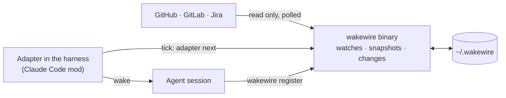

# wakewire docs

wakewire wakes an agent session when something it waits on changes on
GitHub, GitLab or Jira: a review on its pull request, an answer on its spec,
a label that says build it. It exists because an agent waiting on people
moves only when a person writes to its session, and nothing tells it that
someone answered elsewhere. It is shaped as a command-line binary that knows
the services and keeps the state, plus a small adapter inside each harness
that keeps time and delivers the wake, so that nothing runs in the
background, nothing found is ever lost, and a new harness costs only an
adapter. Its first user is unattendish's run-fleet, in Claude Code; bb comes
later.

The design rests on [how wakewire works](explanation/how-wakewire-works.md)
and the [design decisions](explanation/design-decisions.md), which also list
what only running it will prove. The words are in the
[glossary](../GLOSSARY.md).

Status: designed, not built. Every page describes v1 as planned.

## Map

**Explanation**: why it is shaped the way it is.

- [How wakewire works](explanation/how-wakewire-works.md)
- [Design decisions](explanation/design-decisions.md)

**Reference**: the facts to build and use it against.

- [CLI](reference/cli.md): every command, flag, exit code and error code
- [Configuration](reference/configuration.md): paths, accounts, tokens and the source template
- [Wake contract](reference/wake-contract.md): what is watched, what wakes, the wake and the batch
- [Sources](reference/sources.md): what a poll reads from GitHub, GitLab and Jira, and what it costs
- [State](reference/state.md): what `state.db` holds, who holds a watch, leases and pruning
- [The Claude Code mod](reference/claude-code-mod.md): the adapter's lifecycle and what it adds to a session

**How-to** and **tutorials**: none yet; they follow the build.
