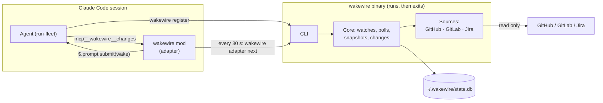
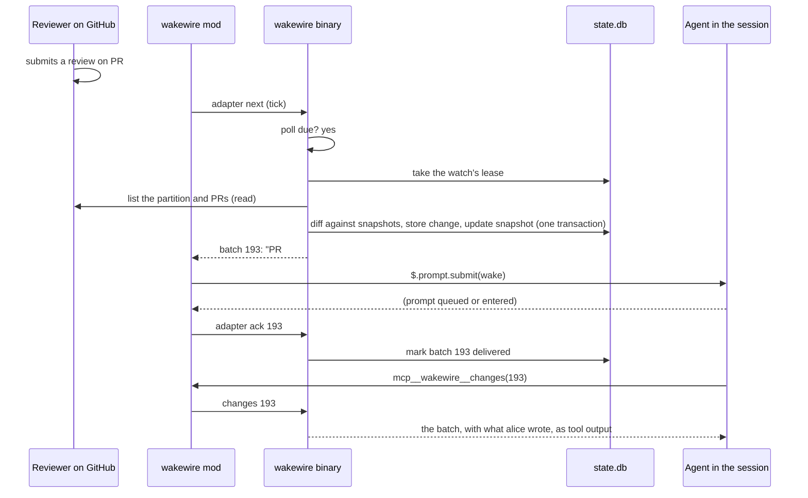
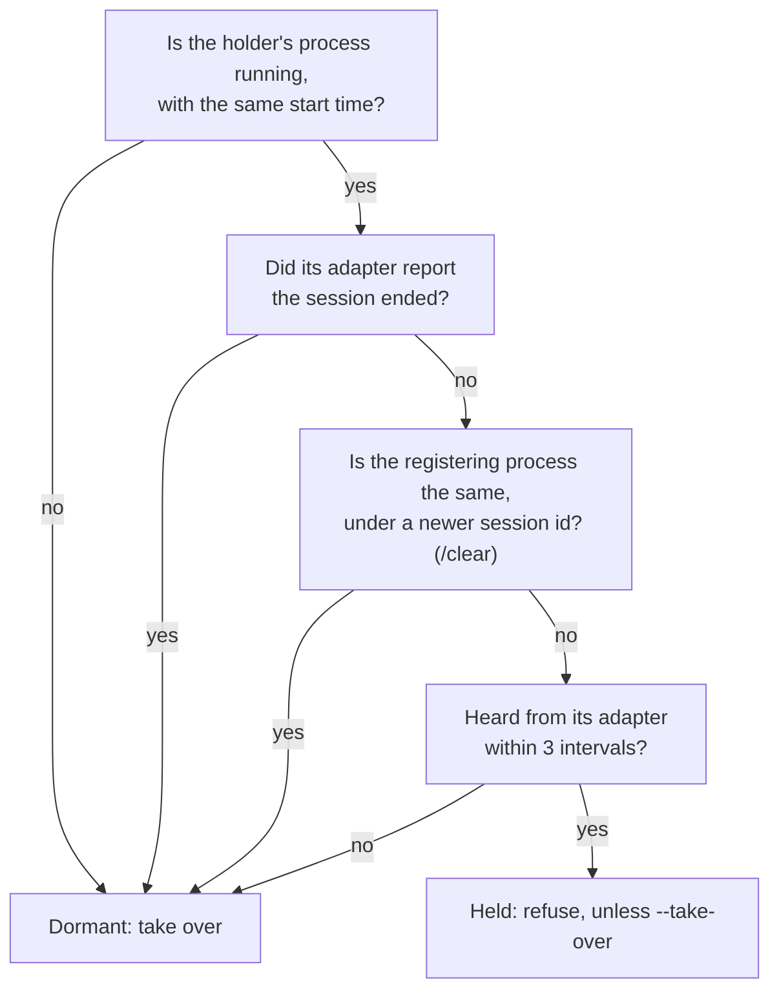

# How wakewire works

wakewire is two pieces: a command-line binary that knows the services and
keeps the state, and an adapter inside the harness that keeps time and wakes
the session. Neither runs in the background on its own: the session is the
clock, and when no session holds a watch, nothing runs at all.

## The flow of one change

## Why the session is the clock

A daemon would have to be installed, started at login, kept alive and told
which sessions exist. wakewire has none of that: the adapter's 30-second tick
runs `wakewire adapter next`, which polls only when the watch's interval has
passed, and returns. A watch nobody holds is not polled, and that costs
nothing, because a change has nowhere to go until a session holds the watch
again, and the snapshots make the first poll then find everything that moved
in between.

The binary owning the interval, rather than the adapter, means
`wakewire interval` takes effect on the next tick without reloading the
adapter, and an undelivered batch is offered again within 30 seconds.

## Why nothing is lost

A change is stored in the same transaction that updates the snapshot it was
diffed against. From then on it exists only in `state.db`, never only in
memory, and its delivery is tracked separately:

| A change is | Until |
|---|---|
| **pending** | it goes out in a batch the adapter acknowledges |
| **held** | the watch is resumed; then it is pending |
| **delivered** | pruned with the ledger after 30 days |
| **ignored** | pruned with the ledger; the reason is kept with it |

A batch the adapter never acknowledges, because the session quit between the
wake and the acknowledgement, leaves its changes pending, so the next holder
gets them again. **A change may be delivered twice and is never lost.** A
repeat is harmless: the session reads the item and finds the change already
handled.

A process killed in the middle of a poll loses only the transaction it was
in, which leaves no trace; the next poll diffs the same items again.

## Why it diffs contents, not timestamps

None of the three services documents which edits move an item's
`updated_at`. A GitLab comment or push does not, and a label change may not;
a GitHub push may not; Jira's search index can lag by minutes. A poll therefore reads each item's current
labels, state, assignees, title, description and head commit, and compares
them with its snapshot; a timestamp only decides whether to also fetch the
item's comments and reviews. Per source, what a poll reads and costs is in
[sources](../reference/sources.md).

## Who holds a watch

One session at a time holds a watch. Whether a registration still holds is
worked out each time someone asks, from facts a crash cannot leave stale,
never from a flag someone has to clear:

The start time matters because an operating system reuses process ids: a
matching id with another start time is another program. The full rules are in
[state](../reference/state.md).

## What crosses into the session, and how

A wake enters the session as a prompt under the mod's name, read by the model
as a turn from its user. So **a wake carries facts only**: what changed, on
which item, by which login, when. It never carries anything a person wrote,
not even a title, since anyone who can comment on the repository could
otherwise write into the session in its user's voice.

What people wrote reaches the agent only when it asks for the batch, through
the mod's own tool or `wakewire changes`. It then arrives as tool output,
which the model weighs as material rather than obeys as instruction. Claude
Code's own guidance points the same way: hook text written as instructions
can trip its prompt-injection defences, so the wake states facts.

## Built for more than one harness

The binary never wakes anyone. It answers `adapter next` with what changed and
leaves delivery to the adapter, and whether a registration is alive is
answered per harness. That keeps the harness-specific part small:

| Harness | Clock | Delivery | Alive while |
|---|---|---|---|
| `claude-code` | the mod's tick | `$.prompt.submit` | its process runs and its mod is heard from |
| `bb` (later) | a bb plugin's timer | `bb thread tell` | its thread is not archived |

A watch can move between harnesses by takeover, since the snapshots and
changes belong to the watch, not to the session.

## Why wakewire is not the fleet

wakewire knows nothing of fleets, manifests, builders or grants: it watches
an identity's work and wakes whoever holds the watch. What run-fleet adds
(the manifest, a board of what waits on the operator) is a separate project,
which can read wakewire through its documented outputs: `status --json`,
`ledger --json` and the [wake contract](../reference/wake-contract.md). The
mod publishes nothing for other mods in v1; the
[design decisions](design-decisions.md#the-mod) say why.
