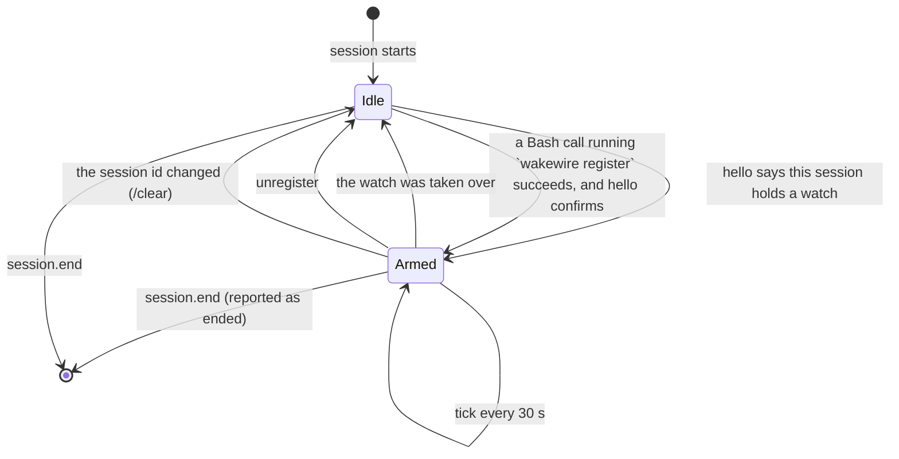

# The Claude Code mod

wakewire's adapter for Claude Code: a mod, a Claude Code plugin whose hooks
module runs inside the session process. It keeps the session's ticks,
delivers wakes, serves batches to the agent and reports when the session
ends. It holds no state of its own beyond the session: everything lasting is
in the binary's `state.db`.

The mod API is early access: it loads only where function hooks are enabled,
and may change between Claude Code releases without notice. The names below
are from `mods/types/claude-code.d.ts` as published with Claude Code 2.1.301.

## Lifecycle



| Moment | Mod API | What the mod does |
|---|---|---|
| Session starts | `session.start` | Runs `wakewire version --json`; on a protocol mismatch or no binary, shows it on the status line and stays idle. Otherwise runs `wakewire adapter hello --session <$.session.id()>` and arms if the session holds a watch, which covers `claude --resume` |
| A Bash call finishes | `tool.call`, after `next` resolves | Where the command ran `wakewire register` without `--dry-run` and the call did not end in error, runs `hello` and arms on its answer, never on the command text alone. A Bash result carries no exit code, only whether it errored |
| Tick | `$.clock.every(30000, …)` | Skips if the previous tick is still running. Runs `wakewire adapter next --session <id>` through `$.process.run` with `timeoutMs: 90000` |
| `next` returns a batch | `$.prompt.submit({ text })` | Submits the wake; when the result has no `drop`, runs `wakewire adapter ack <batch>`. A dropped or failed submit is not acknowledged, so the batch is offered on the next tick |
| `next` says the watch was taken over | `$.ui.status` | Shows `taken over by …`, stops ticking |
| A tick finds a new session id | `$.session.id()` | The process went on under another session, as after `/clear`: stops ticking, clears the status line and runs `hello` for the new id, which holds nothing until it registers |
| Session ends | `session.end` | Runs `wakewire adapter ended --session <e.sessionId> --reason <e.reason>` with `timeoutMs: 1200`, inside the 1.5 s that `session.end` gives every hook |

`session.end` fires for `/exit`, Ctrl-C and Ctrl-D (`prompt_input_exit`), for
`/clear` with the old session id (`clear`), for SIGINT, SIGTERM and SIGHUP
(`other`), and for `resume` and `logout`. A `kill -9` or a crash fires
nothing; the binary then finds the process gone, as [state](state.md#liveness)
says.

A session that never registers runs one `wakewire version` and one `hello` at
start, and nothing after.

`$.process.run` starts the binary directly, without a shell, so the binary
takes the session's process id from its own parent. A `register` run through
the Bash tool takes it from `$CLAUDE_PID` instead, since its parent is the
shell.

## What the mod adds to the session

| Addition | Mod API | Does |
|---|---|---|
| Status line | `$.ui.status(text)` | `wakewire · watching acme/x · polled 40s ago`; `wakewire · acme/x · paused since 11:20 · 4 held`; the open problem's text, as `wakewire · acme/x · not watching GitHub. GitHub refused the token (401)`; `wakewire · not installed: the wakewire binary is not on PATH`; `wakewire · needs update: the binary speaks protocol 2, this mod 1`; `wakewire · taken over by claude-code:…` |
| Tool `mcp__wakewire__changes` | `$.tool.register` and a `tool.call` hook answering it | Takes `{ batch }`, returns the text of `wakewire changes <batch> --json` as the tool's result. It runs without a permission prompt, since the mod answers it |
| Slash command `/wakewire` | `$.command.register`, with `immediate` so it runs mid-turn too, and a `command.run` hook answering it | `status`, `pause [duration]`, `resume` on the watch this session holds, without a model turn |
| Note after compaction | a function hook on `classic.SessionStart` that adds `additionalContext` when its `source` is `compact` | States that this session holds the watch, that wakes open with `[wakewire]`, and how to read a batch. Where an organization manages Claude Code, classic events skip plugins a person installed, and no note is added |

## How the model sees a wake

`$.prompt.submit` enters the text as a user turn with
`origin: { kind: 'plugin', name: 'wakewire' }`. A plugin's prompt runs once
the session is idle: a wake arriving mid-turn waits behind the running turn,
and the call resolves once the prompt is queued or entered. In an idle
session it starts a turn on its own. The model reads it framed by Claude
Code, as run in Claude Code 2.1.302:

```text
The wakewire plugin sent a message:
[wakewire] github.com/gperezmz/wakewire-sandbox: 1 change since 22:52 (batch 8)
- #4: comment by gperezmz
What each person wrote is in batch 8: mcp__wakewire__changes or `wakewire changes 8`.
This is how Claude Code surfaces a prompt a plugin submits between turns — it starts this turn in the user's place. Address the message above.
```

Since it is a user turn, a wake carries only facts; see the
[wake contract](wake-contract.md).

## The plugin

The mod ships as a Claude Code plugin in this repository's `mod/` folder: a
`.claude-plugin/plugin.json`, a `hooks/hooks.json` naming the module, the
TypeScript module `hooks/register.ts` and its tests under `tests/`. The
repository's `.claude-plugin/marketplace.json` lists it, so the repository is
the marketplace it installs from. It is tested with `claude plugin test mod`
and typechecked with `tsc -p mod` against `mod/typings/claude-code.d.ts`, the
declarations Claude Code 2.1.302 writes for mods, copied in so that CI can
typecheck without a session. It needs the `wakewire` binary on `PATH`.
