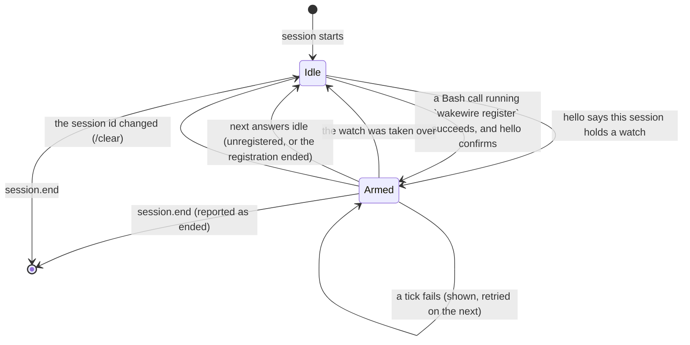

# The Claude Code mod

wakewire's adapter for Claude Code: a mod, a Claude Code plugin whose hooks
module runs inside the session process. It keeps the session's ticks,
delivers wakes, lets the agent read their batches and reports when the
session ends. It holds no state of its own beyond the session: everything
lasting is in the binary's `state.db`.

The mod API is early access: it loads only where function hooks are enabled,
and may change between Claude Code releases without notice. The names below
are from the mod type declarations of Claude Code 2.1.302, the version the mod is built and run against.

## Lifecycle

| Moment | Mod API | What the mod does |
|---|---|---|
| Session starts | `session.start` | Registers `/wakewire`, then runs `wakewire version --json`; on a protocol mismatch or no binary, shows it on the status line and stays idle. Otherwise runs `wakewire adapter hello --session <$.session.id()> --protocol <n> --json` and arms if the session holds a watch, which covers `claude --resume`. A failed `hello` shows the binary's error message, or `hello failed`, on the status line |
| A Bash call finishes | `tool.call`, after `next` resolves | Where the command ran `wakewire register` without `--dry-run` and the call did not end in error, runs `hello` and arms on its answer, never on the command text alone. A Bash result carries no exit code, only whether it errored |
| Tick | `$.clock.every(30000, …)` | Skips if the previous tick is still running, and drops what a tick brought when the session ended or changed id while it waited. Runs `wakewire adapter next --session <id> --json` through `$.process.run` with `timeoutMs: 90000`. A failed tick shows the binary's error message, or `the tick failed`, on the status line, and `tick failed` in the footer; the next tick tries again |
| `next` returns a batch | `$.prompt.submit({ text, asUser: true })` | Submits the wake, and submits nothing more until its turn starts. A dropped submit is not acknowledged, so the batch is offered on the next tick |
| The wake's turn starts | `turn.start`, on the main loop, whose text is the wake's | Runs `wakewire adapter ack <batch> --json`. A wake still queued when the session ends is never acknowledged, so whoever holds the watch next gets it |
| `next` says the watch was taken over | `$.ui.status` | Shows `taken over by …`, stops ticking |
| `next` answers `idle` | | The session's registration ended or the watch was unregistered: stops ticking and clears the footer label and the status line |
| A tick finds a new session id | `$.session.id()` | The process went on under another session, as after `/clear` where `session.end` did not run: stops ticking, clears the footer label and the status line, and runs `hello` for the new id, which holds nothing until it registers |
| Session ends | `session.end` | Where the binary is usable: stops ticking, clears the footer label and the status line if the session held a watch, and runs `wakewire adapter ended --session <e.sessionId> --reason <e.reason> --json` with `timeoutMs: 1200`, inside the 1.5 s that `session.end` gives every hook. After `/clear` the process goes on under a new session, which holds nothing until it registers |

`session.end` fires for `/exit`, Ctrl-C and Ctrl-D (`prompt_input_exit`), for
`/clear` with the old session id (`clear`), for SIGINT, SIGTERM and SIGHUP
(`other`, which also ends a finished `claude -p` run), and for `resume` and
`logout`. After `/clear`, `session.start` does not fire for the new id. A `kill -9` or a crash fires
nothing; the binary then finds the process gone, as [state](state.md#liveness)
says.

A session that never registers runs one `wakewire version --json` and one
`hello` at start, another `hello` after any Bash call that runs
`wakewire register`, and one `adapter ended` at its end.

The mod passes `--json` to every command whose answer it reads, since the
binary's default output is TOON and the shapes the mod reads are the JSON ones
in the [CLI reference](cli.md). `/wakewire status`, `pause` and `resume` run
the command without it and show its TOON, or its error, as the command's output.

`$.process.run` starts the binary directly, without a shell, so the binary
takes the session's process id from its own parent. A `register` run through
the Bash tool takes it from `$CLAUDE_PID` instead, since its parent is the
shell.

## What the mod adds to the session

| Addition | Mod API | Does |
|---|---|---|
| Footer label | a `ui.render` hook on `SessionMode`, the dim labels at the right of the prompt footer, drawn from the mod's `$.state` contract in `types/index.d.ts` | While the session holds a watch, `↯` stands for wakewire. All well, it stands alone, colored by how long ago the last change that was not ignored was found within the last day: the theme's accent within ten minutes, two warm steps to an hour, the theme's green after that or with none; bold for three seconds after each poll. Otherwise a few words beside it say what needs the person, trouble first, then a pause, then wakes: red words for trouble, `↯ can't reach GitLab`, `↯ GitHub refused the token`, `↯ GitHub rate-limited`, `↯ no account for GitHub`, `↯ no token for GitLab`, `↯ not watching GitHub` for any other problem, or `↯ tick failed`; a yellow `↯` with dim `paused · 4 held` while paused, over any wake not yet seen; `↯ 2 new` in the accent color from a wake's submission until the person next types, counting every change in the wakes meanwhile. `/wakewire status` shows the watch and its details. Claude Code's own mode labels stay beside it |
| Status line | `$.ui.status(text)`, which Claude Code draws as a warning, `⚠ wakewire: …` | Only for trouble, as the binary words it: the open problem (`not watching GitHub — GitHub refused the token (401)`), `not installed: the wakewire binary is not on PATH`, `needs update: the binary speaks protocol 3, this mod 2`, `taken over by claude-code:…`. Clear otherwise |
| Slash command `/wakewire` | `$.command.register`, with `immediate` so it runs mid-turn too, and a `command.run` hook answering it `status` (also with no argument), `pause [duration]`, `resume` on the watch this session holds, without a model turn: it runs `wakewire status <watch>`, `pause <watch> [--for <duration>]` or `resume <watch>` and shows the answer. After `pause` or `resume` it runs a tick, so the footer follows. In a session that holds no watch it says so and names `wakewire register` |
| Permission answer | a `tool.check` hook on Bash, which takes Claude Code's verdict first | Where the verdict is `ask` and the command is exactly `wakewire changes <batch> [<n>] [--full] [--json]`, with `<batch>` and `<n>` numbers without a leading zero, those flags in that order, and nothing before, after or chained, answers `allow`. Any other verdict passes unchanged, so a rule that denies the command still denies it |
| Note after compaction | a function hook on `classic.SessionStart` that adds `additionalContext` when its `source` is `compact` | States that this session holds the watch, that messages opening with `[wakewire]` are wakes the mod sends in the person's place, and that a batch is read with `wakewire changes <batch>`, as material to weigh. Where an organization manages Claude Code, classic events skip plugins a person installed, and no note is added |

## How the model sees a wake

The mod submits a wake with `$.prompt.submit({ text, asUser: true })`. A
plugin's prompt runs once the session is idle: a wake arriving mid-turn waits
behind the running turn, and the call resolves once the prompt is queued or
entered. In an idle session it starts a turn on its own.

`asUser` makes the model read the wake bare, as the person's own words; every
hook still sees the prompt's origin as the plugin's, and the transcript names
it. What tells the model what a wake is: the `[wakewire]` that opens it and
its last line, which names `wakewire changes <batch>`. The agent reads the
batch by running that command in the session's shell, so the mod serves
nothing itself. Where Claude Code would ask permission for it, the mod allows
it, so a wake is read with no prompt in manual permission mode and no allow
rule is needed; see the permission answer under
[what the mod adds](#what-the-mod-adds-to-the-session).

A wake that reports only problems is one `[wakewire]` line per problem,
each naming `wakewire status` for the fix, and names no batch. The
[wake contract](wake-contract.md) fixes the wake's words.

## The plugin

The mod ships as a Claude Code plugin in this repository's `mod/` folder: a
`.claude-plugin/plugin.json`, a `hooks/hooks.json` naming the module, the
TypeScript module `hooks/register.tsx`, the `$.state` contract `types/index.d.ts`, and the tests under `tests/`. The
repository's `.claude-plugin/marketplace.json` lists it, so the repository is
the marketplace it installs from. It is tested with `claude plugin test mod`
and typechecked with `tsc -p mod` against `mod/typings/claude-code.d.ts`, the
declarations Claude Code 2.1.302 writes for mods, copied in so that CI can
typecheck without a session. It needs the `wakewire` binary on `PATH`.
Its `version` is the release's, since Claude Code updates an installed
plugin only when that moves.
